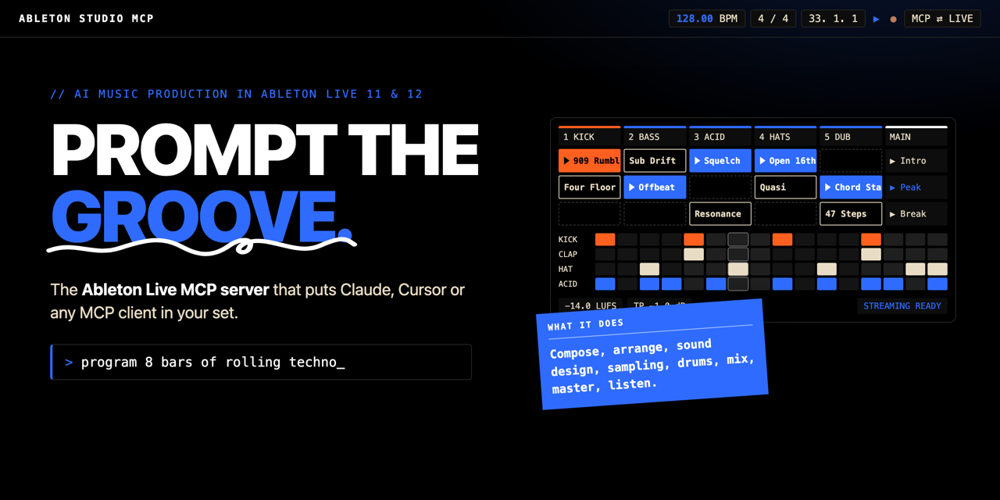

<div align="center">



# Ableton Studio MCP

**The Ableton Live MCP server that lets Claude (or any MCP client) compose, arrange, mix, master, listen to and analyse music in Ableton Live 11 & 12.**

By **Olivier Cedrati** ([@cedrati](https://github.com/cedrati)) — built on [ableton-mcp](https://github.com/ahujasid/ableton-mcp) by Siddharth Ahuja.

[](https://github.com/cedrati/ableton-studio-mcp/blob/main/LICENSE)
[](https://pypi.org/project/ableton-studio-mcp/)


[](https://github.com/cedrati/ableton-studio-mcp/actions/workflows/tests.yml)

[Quickstart](#quickstart) · [Features](#features) · [Tools](#tool-reference) · [FAQ](#faq) · [Roadmap](https://github.com/cedrati/ableton-studio-mcp/issues?q=is%3Aissue+is%3Aopen+label%3Aroadmap) · [Changelog](https://github.com/cedrati/ableton-studio-mcp/blob/main/CHANGELOG.md) · [Issues](https://github.com/cedrati/ableton-studio-mcp/issues)

</div>

---

## About

**AI music production in Ableton Live.** This is a [Model Context Protocol](https://modelcontextprotocol.io) (MCP) server and Ableton Remote Script that connect Ableton Live to Claude, Claude Code, Claude Desktop, Cursor and other MCP clients, so an AI assistant can work inside your Live set: write MIDI, program drums, build arrangements, mix with Live's devices, check loudness (LUFS) and true peak, and reason about harmony.

[Ableton MCP](https://github.com/ahujasid/ableton-mcp), created by Siddharth Ahuja, connects Ableton Live to AI assistants through the [Model Context Protocol](https://modelcontextprotocol.io): the assistant can create tracks and clips, write notes, load devices and drive the transport.

**Ableton Studio MCP, written and maintained by Olivier Cedrati, builds on it and turns it into a full production assistant.** Beyond writing notes, the assistant can mix (faders, sends, return and main-track effects, routing), **listen** to the result and judge it like a mastering engineer (LUFS, true peak, tonal balance, stereo, a spectrogram it can look at), and compose with real music-theory knowledge (scales and modes, style sheets, key and chord analysis, clip transformations, voice-led progressions).

It is developed on the `feat/mixer-scenes` branch of [cedrati/ableton-studio-mcp](https://github.com/cedrati/ableton-studio-mcp). It is published on PyPI as [`ableton-studio-mcp`](https://pypi.org/project/ableton-studio-mcp/). (The `ableton-mcp` package on PyPI is the **original** project and does not include any of this.)

**No data is collected:** no telemetry, no analytics, nothing sent anywhere (see [Privacy](#privacy)).

## Features

| Area | What the assistant can do |
|---|---|
| **Mixing** | Volume, pan, sends, mute, solo, arm on tracks, return tracks and the main track. Load effects on return tracks and the main track (a shared reverb, a limiter). Read every parameter as Live displays it (`Bell`, `1.56 kHz`, `-6.0 dB`). |
| **Routing** | Set track inputs, outputs and monitoring: layer one MIDI part on several instruments, resample the main output, route to a return. |
| **Listening & mastering analysis** | Record the main output in real time and get a report: loudness per ITU-R BS.1770 / EBU R128 (integrated, short-term, momentary, loudness range), true peak, PLR, tonal balance against a reference curve, resonances, stereo width per band, low-end mono, each track's meter level, a spectrogram image — and ranked findings with fixes for a delivery target (streaming, club, classical, broadcast, podcast). |
| **Drums** | Program a Drum Rack from 19 electronic patterns (techno, house, garage, breaks, d'n'b...) or your own step grids: pads found by name, Euclidean and polyrhythmic layers, ratchets, ghost notes, per-note probability, fills, swing, Live's Groove Pool. |
| **Long-form evolution & arrangement** | Curves over 16–64 bars (filter builds, reverb swells, slow LFOs, phrase steps) on extended clips; whole Arrangements built from Session clips by section (DJ-friendly techno, compact 64 bars, minimal, house) with locators — the clip envelopes play as track automation. |
| **Music theory** | ~50 scales and modes with their character and typical styles; 24 style sheets (baroque to techno); key, mode and chord analysis of a clip with roman numerals; 17 clip transformations (mode change, diatonic transposition, harmonization, arpeggios, voicings, swing...); voice-led chord progressions; Live 12's song scale. |
| **Clips** | Notes in Arrangement clips, partial note removal, loop brace and markers, warp (modes, markers, conform a loop to the tempo), clip automation envelopes. |
| **Files** | Import Standard MIDI Files into clips; analyse any WAV/AIFF. |
| **Session** | Duplicate and delete tracks; list, create, rename, duplicate, launch and delete scenes; delete Arrangement clips. |
| **Devices & browser** | Know every device in the set and what it does (native devices from the Live 12 manual, Max for Live, plug-in families) and every installed plug-in; route a Compressor's sidechain; plug-in presets; Simpler sample loading and slicing; rack variations; drum choke groups. Plugins (VST, VST3, AU), User Library and Packs load like built-in devices. |
| **Reliability** | Playhead moves, locator creation and device loading reply only once Live has applied them; version handshake between server and Remote Script; capability checks so a newer server never sends a command an older script would misread. |

Everything is covered by automated tests (271) and checked end to end in Ableton Live 12. See the [Changelog](https://github.com/cedrati/ableton-studio-mcp/blob/main/CHANGELOG.md) for the details of each release.

---

## Quickstart

### Requirements

- **Ableton Live 11 or 12** (Live 12 for the song scale; Live 10 works for the original features)
- **[uv](https://docs.astral.sh/uv/getting-started/installation/)** — on macOS: `brew install uv`
- An MCP client: Claude Code, Claude Desktop, Cursor...

Python (3.10+) and the dependencies, including `numpy`, are installed automatically by `uv`.

### 1. Add the server to your MCP client

<details open>
<summary><b>Claude Code</b></summary>

```bash
claude mcp add ableton -s user -- uvx ableton-studio-mcp
```
</details>

<details>
<summary><b>Claude Desktop</b> — Settings → Developer → Edit Config</summary>

```json
{
  "mcpServers": {
    "AbletonStudioMCP": {
      "command": "uvx",
      "args": ["ableton-studio-mcp"]
    }
  }
}
```
</details>

<details>
<summary><b>Cursor</b> — Settings → MCP, as a command</summary>

```
uvx ableton-studio-mcp
```
</details>

Run the server in **one** client at a time.

### 2. Install the Remote Script into Live

```bash
uvx ableton-studio-mcp install
```

This copies the **AbletonStudioMCP** control surface into your User Library's `Remote Scripts` folder, found from Live's own settings (`--list-targets` shows where it would go, `--target <folder>` forces a location, `--dry-run` changes nothing).

**Coming from 1.x?** The control surface was called *AbletonMCP* before 2.0. Deselect it in Live and run `uvx ableton-studio-mcp install --remove-legacy` to delete the old folder: both listen on the same port.

The server and the Remote Script must come from the **same version** — always install both from this repository.

### 3. Enable it in Live

1. Start (or **restart**) Ableton Live.
2. **Settings → Link, Tempo & MIDI → Control Surface:** choose **AbletonStudioMCP**, with Input and Output set to **None**.

### 4. Check

Run the built-in check, which looks at Python, uv, the script installed in your User Library, the Control Surface setting and the script actually running in Live, and says what to fix:

```bash
uvx ableton-studio-mcp doctor
```

Or ask the assistant to run `get_remote_script_info`: it should report `script_version` **2.0.0** and `up_to_date: true`.

### Updating

1. Fetch the new version and install its Remote Script: `uvx --refresh ableton-studio-mcp install`
2. **Restart Live** — re-selecting the control surface does not reload the code.
3. Restart your MCP client. If it still runs old code: `uv cache clean ableton-studio-mcp` (with the client closed).
4. `uvx ableton-studio-mcp doctor` confirms that everything matches.

To try unreleased changes, use the development branch instead of PyPI: replace `ableton-studio-mcp` with `--from git+https://github.com/cedrati/ableton-studio-mcp@feat/mixer-scenes ableton-studio-mcp` in the commands above.

---

## What you can ask

**Compose and arrange**
- *"Write a C minor organ fugue: subject, answer at the fifth, countersubject, stretto."*
- *"Give me a deep house progression in A minor with offbeat stabs, then a rolling bassline."*
- *"Analyse the clip on track 2: key, chords, roman numerals."*
- *"Re-harmonise this melody in Dorian, add a third above, swing it at 58 %."*
- *"Import this MIDI file and transpose it to F#."*
- *"Program 8 bars of rolling techno on the 909 kit, with a 5-in-16 percussion layer and a clap roll every 4 bars."*
- *"Open the acid bass filter over 16 bars, then lay out a 64-bar techno arrangement with a DJ intro and outro."*

**Mix and master**
- *"Listen to the whole track and tell me if it's ready for streaming."*
- *"What's loaded in this set, and which of my plug-ins would make a better acid line?"*
- *"Duck the bass with the kick."*
- *"Put a cathedral reverb on return A and send the pads to it."*
- *"The low end is muddy — find out why and fix it."*
- *"Layer the bass MIDI on a second synth one octave down."*

---

## Tool reference

Indexes start at 0. Times and lengths are in **beats**. Notes use MIDI numbers (60 = C4 in scientific pitch, shown as C3 in Live).

### Session and transport

| Tool | Description |
|---|---|
| `get_session_info` / `get_session_snapshot` | Tempo, time signature, tracks, transport; full state dump. |
| `set_tempo` · `start_playback` · `stop_playback` | Transport. |
| `get_scenes` · `create_scene` · `set_scene_name` · `duplicate_scene` · `fire_scene` · `delete_scene` | Scenes. |
| `switch_to_arrangement_view` · `set_arrangement_time` · `create_locator` · `delete_locator` | Arrangement view, playhead, locators (create, rename, delete by name or position). |
| `get_remote_script_info` | Version handshake and capabilities. |

### Tracks, mixer and routing

| Tool | Description |
|---|---|
| `create_midi_track` · `create_audio_track` · `set_track_name` · `duplicate_track` · `delete_track` | Tracks. |
| `get_track_info` | Track, return track (`track_type="return"`) or main track (`"master"`): mixer state, clip slots, devices. |
| `set_track_volume` · `set_track_panning` · `set_track_send` · `set_track_mute` · `set_track_solo` · `set_track_arm` | Mixer; reply with Live's display value (`-6.0 dB`, `25L`). `track_type` reaches return tracks and the main track. |
| `get_track_routing` · `set_track_routing` | Input/output type and channel, monitoring (`in`, `auto`, `off`), matched by the names Live shows. |
| `get_track_meters` | Live's output meter of every track, return and the main track. |

### Devices and browser

| Tool | Description |
|---|---|
| `get_browser_tree` · `get_browser_items_at_path` | Browse `instruments`, `sounds`, `drums`, `audio_effects`, `midi_effects`, `plugins`, `user_library`, `packs`, `samples`, `max_for_live`, `current_project`. |
| `load_instrument_or_effect` · `load_drum_kit` | Load by browser URI, on a track, a return track or the main track. |
| `get_device_parameters` · `set_device_parameter` | Every parameter with its range, Live's display string and, for list parameters, the names of the values. |
| `device_inventory` | Every device in the set and what it is for; optionally every installed plug-in by vendor. |
| `device_knowledge` | Sheet for a native device (Live 12 manual), a bundled Max for Live device or a known plug-in; the native catalogue. |
| `get_device_info` | Real device name, kind, latency, and device-specific state: sidechain, plug-in presets, Simpler, rack. |
| `set_device_sidechain` | Route a Compressor's sidechain from another track and switch it on (ducking). |
| `plugin_presets` | List or select a plug-in's presets (as exposed to Live). |
| `simpler_sample` | Load a sample into Simpler; classic / one-shot / slicing by transient, beat, region; warp, crop, reverse. |
| `rack_variation` · `set_drum_choke` | Rack macro variations (list, recall, store, randomize); Drum Rack choke groups. |

### Clips and notes

| Tool | Description |
|---|---|
| `create_clip` · `create_audio_clip` · `set_clip_name` · `fire_clip` · `stop_clip` · `delete_clip` | Session clips. |
| `get_clip_notes` · `add_notes_to_clip` · `clear_notes_from_clip` · `remove_notes` | Notes, in Session or Arrangement clips (`location="arrangement"`); `remove_notes` clears a time/pitch range only. |
| `get_clip_loop` · `set_clip_loop` | Loop switch, loop brace, start/end markers. |
| `get_clip_warp` · `set_clip_warp` · `edit_warp_markers` | Warp mode, markers, pitch, gain; `original_bpm` conforms a loop to the tempo. |
| `get_clip_automation` · `set_clip_automation` | Clip envelopes for device and mixer parameters (Session clips). |
| `get_arrangement_clips` · `duplicate_to_arrangement` · `set_arrangement_clip_name` · `delete_arrangement_clip` | Arrangement clips. |
| `import_midi_file` | Import a `.mid` file (track/channel filters, transposition) or describe it. |

### Listening and analysis

| Tool | Description |
|---|---|
| `listen_to_arrangement` | Records the main output between two song positions on a temporary track (in real time), samples every track's meter, then returns the mix report and the spectrogram image. The track and the recorded file are deleted afterwards, so listening never fills the project with audio (`keep_track` / `keep_audio` to keep them). |
| `analyze_mix` | The same mastering report for any WAV/AIFF file. |
| `analyze_audio_file` | Lightweight level report (no `numpy` needed). |
| `record_arrangement` · `get_recording_status` · `stop_arrangement_recording` · `get_audio_clip_file` | Record armed tracks into the Arrangement between two positions; find the recorded file. |

The mix report checks: integrated / short-term / momentary loudness and loudness range (validated on EBU reference signals), true peak (4× oversampled), PLR and crest factor, long-term spectrum and its tilt against a −4.5 dB/octave reference (sub, lows, low-mids, mids, high-mids, highs, air), narrow peaks with their note names, stereo correlation and width per band, low-end mono, DC offset. Each finding comes with a severity and a concrete fix using Live's own devices.

### Drums and groove

| Tool | Description |
|---|---|
| `drum_patterns` | Pattern library (techno four, rolling, hypnotic, minimal, dub, hard, acid, Detroit, house, deep house, tech house, afro house, UK garage, breakbeat, electro, drum & bass, dubstep, trap, EBM) with tempo, swing and production notes; Euclidean rhythms. |
| `get_drum_map` | A track's Drum Rack pads and the role each plays (kick, clap, hats, perc...). |
| `write_drum_pattern` | Program a clip from a style and/or grids per role: `x` hit, `X` accent, `o` ghost, `2`-`4` ratchet, `?`/`*` probability; Euclidean layers, swing, fills, variation, humanize. |
| `get_groove_pool` · `set_clip_groove` · `set_groove_params` | Live's Groove Pool: list grooves, apply one to a clip, adjust amounts and the global Groove amount. |

### Evolution and arrangement

| Tool | Description |
|---|---|
| `write_clip_evolution` | Extend a MIDI loop to N bars and write long curves per lane (device parameter or volume/pan/send): linear, exp build-up, log, S-curve, swell, slow sine/triangle, steps, random walk. |
| `build_arrangement` | Lay out the Arrangement from Session clips by section (template or custom), roles from track names, per-section clip variants, tiling, locators, `dry_run`. Envelopes of the placed clips become track automation. |
| `arrangement_overview` | Map of which track plays in each block of bars. |
| `arrangement_templates` | Templates (`techno_dj`, `techno_64`, `minimal`, `house`) and curve shapes. |

### Music theory and composition

| Tool | Description |
|---|---|
| `music_scales` | ~50 scales and modes — church modes, harmonic/melodic minor families, pentatonics, blues, bebop, symmetric, Japanese, gamelan, flamenco — with character, characteristic note, styles; or one scale in a key: spelled notes, diatonic chords with roman numerals and functions, relative modes, Live's name. |
| `music_styles` | 24 style sheets (baroque, classical, jazz, bossa nova, blues, gospel/neo-soul, funk, pop, rock, house, techno, trance, drum & bass, boom bap, lo-fi, trap, R&B, reggae, reggaeton, afrobeat, flamenco, film score, ambient, synthwave): tempo, metre, scales, harmony, progressions, groove and swing, bass, melody, arrangement, Live devices. |
| `music_chord_ideas` | Reharmonisation ideas for a chord, with the reason for each. |
| `analyze_clip_music` | Key and mode, chords with roman numerals (`basic` or `jazz` vocabulary), out-of-scale notes, range, rhythm, melodic motion. |
| `transform_clip` | Chain of operations, in place or into an empty slot: `transpose`, `transpose_diatonic`, `change_mode`, `snap_to_scale`, `invert`, `retrograde`, `time_scale`, `quantize`, `swing`, `humanize`, `accent`, `articulate`, `fold_range`, `harmonize`, `arpeggiate`, `strum`, `voice_chords`. |
| `write_progression` | Roman numerals (secondary dominants, borrowed chords, Neapolitan) or a style's progression, voice-led, played with an accompaniment pattern and a bass line. |
| `get_song_scale` · `set_song_scale` | Live 12's song scale and Scale Mode. |

### Good to know

- **Live's API has limits.** A script cannot save the set, export audio, create group tracks, or write Arrangement automation directly (tempo changes included). Track automation still reaches the Arrangement through Session clip envelopes, which `build_arrangement` places for you. Live's own analysers (Spectrum, EQ Eight's display, Max for Live meters) don't expose their readings — which is why listening works by recording the main output.
- **Listening takes real time:** analysing a 3-minute song means playing it for 3 minutes.
- **Device loading, playhead moves and locators** reply only once Live has applied them. Loading the same device that is already on a track resets it in place (the reply says so).
- **Destructive tools** (`delete_track`, `delete_scene`, `delete_clip`, `delete_arrangement_clip`) do what they say — save your set before big experiments.

---

## FAQ

**Does Ableton Studio MCP collect any data?**
No. There is no telemetry, no analytics and no data collection of any kind, and the server makes no internet connection: everything stays between your MCP client and Live on your computer. See [Privacy](#privacy).

**How do I control Ableton Live with Claude?**
Install this MCP server in Claude Code, Claude Desktop or Cursor, install the Remote Script into Live, and select *AbletonStudioMCP* as a control surface (see [Quickstart](#quickstart)). Then ask in plain language: *"program 8 bars of rolling techno on the 909 kit"*.

**Can an AI mix and master in Ableton Live?**
It can measure and act: `listen_to_arrangement` records the main output and reports integrated loudness (LUFS, EBU R128), true peak, loudness range, tonal balance, resonances and stereo width against a target (streaming −14 LUFS, club, classical, broadcast, podcast), with a spectrogram image the assistant looks at; the mixer, EQ Eight, Limiter, Compressor sidechain and other devices are then adjusted through the API.

**Does it work with Ableton Live 12, Live 11, Push, Max for Live?**
Live 11 and 12 (Live 12 for the song scale and some device features). Max for Live devices and VST/AU plug-ins load like built-in devices; Push and other control surfaces keep working alongside it.

**Which MCP clients are supported?**
Any MCP client: Claude Code, Claude Desktop, Cursor, and others that speak the Model Context Protocol.

**Can it make techno and electronic music?**
Yes — drum programming from 19 electronic styles or step grids (Euclidean rhythms, ratchets, per-note probability), long filter builds over 64 bars, DJ-friendly arrangements with intro and outro, sidechain ducking, and a club loudness target.

**What's next?**
The [roadmap](https://github.com/cedrati/ableton-studio-mcp/issues?q=is%3Aissue+is%3Aopen+label%3Aroadmap) lists the planned work: sound design recipes, A/B comparison with reference tracks, finding samples by sound, audio-to-MIDI transcription, and more. Ideas and contributions are welcome in the issues.

**What can't it do?**
Live's API doesn't let a script save the set, export audio, create group tracks, write Arrangement automation directly or use Live 12's MIDI Tools; see [Good to know](#good-to-know).

---

## Troubleshooting

Start with `ableton-studio-mcp doctor` (see [Check](#4-check)): it diagnoses most of the cases below.

| Problem | Fix |
|---|---|
| `up_to_date: false`, or "missing capability" errors | The script in Live is older than the server. Re-run the install command, then **restart Live**. |
| The server still runs old code after an update | Restart the MCP client; if needed `uv cache clean ableton-studio-mcp` with the client closed. |
| No connection | Check that **AbletonStudioMCP** is selected as a Control Surface and that only one MCP client runs the server. |
| Timeouts on big requests | Ask for the work in smaller steps. |

---

## How it works

```
MCP client (Claude…)  ⇄  MCP server (ableton_studio_mcp/, Python)  ⇄  TCP 127.0.0.1:9877  ⇄  AbletonStudioMCP control surface inside Live (ableton_studio_mcp/live_script/)
```

- The **Remote Script** runs inside Live and executes commands through Live's Python API. It listens on localhost only (set `ABLETON_MCP_HOST` deliberately to change that).
- The **MCP server** exposes the tools, checks the script's version and capabilities, and does the heavy work outside Live: audio analysis, MIDI files, music theory.
- Messages are JSON objects: `{"type": ..., "params": ...}` → `{"status": ..., "result" | "message": ...}`.

### Development

```bash
git clone -b feat/mixer-scenes https://github.com/cedrati/ableton-studio-mcp
cd ableton-studio-mcp
uv run --with pytest pytest -q             # 271 tests, no Live needed
uv run ableton-studio-mcp install          # install your working copy into Live
uv run ableton-studio-mcp doctor           # check the whole chain
```

The Live control surface lives in `ableton_studio_mcp/live_script/AbletonStudioMCP/` and is shipped inside the package. One version number covers everything: when the protocol changes, bump `__version__` in `ableton_studio_mcp/__init__.py`, `SCRIPT_VERSION` in the control surface and `version` in `pyproject.toml` (the tests and the release workflow check they match), and add an entry to the [Changelog](https://github.com/cedrati/ableton-studio-mcp/blob/main/CHANGELOG.md). GitHub Actions runs the tests on Python 3.10, 3.12 and 3.13 on every push and pull request.

**Releasing:** push a tag `vX.Y.Z` matching that version. The `release` workflow checks the versions, runs the tests, builds the package, publishes it to PyPI (trusted publishing, no token stored) and creates the GitHub release.

---

## Privacy

**No data is collected. None.** Ableton Studio MCP has no telemetry, no analytics, no usage statistics, no crash reporting and no account.

- **Nothing leaves your computer.** The server only talks to Ableton Live on your own machine (127.0.0.1) and makes no internet connection.
- **Your music, your Live sets and your prompts stay with you.** Tools do not receive your prompts, and nothing about your sessions is recorded or sent.
- **No tracking in Live.** The Remote Script only answers the commands it is sent; it does not watch or log what you do.
- The telemetry and research-dataset recording inherited from the original ableton-mcp were **removed from the code entirely** in 1.17.0, along with their online-database dependency (Supabase). Nothing is merely switched off: the code is gone.

The only files the tools write are on your machine (recordings you ask for, temporary spectrogram images, the Remote Script itself): the full list is in [TERMS.md](https://github.com/cedrati/ableton-studio-mcp/blob/main/TERMS.md).

---

## Credits and license

- **Original project:** [ableton-mcp](https://github.com/ahujasid/ableton-mcp) by [Siddharth Ahuja](https://x.com/sidahuj).
- **Ableton Studio MCP:** Olivier Cedrati ([@cedrati](https://github.com/cedrati)) — mixing and routing, listening and mastering analysis, music theory, drums and groove, long-form evolution and arrangement, device knowledge, clip editing, MIDI import and reliability work. Report issues on [cedrati/ableton-studio-mcp](https://github.com/cedrati/ableton-studio-mcp/issues).

MIT License — Copyright (c) 2026 Olivier Cedrati; portions Copyright (c) 2025 Siddharth Ahuja (original ableton-mcp, on which Ableton Studio MCP is built). See [LICENSE](https://github.com/cedrati/ableton-studio-mcp/blob/main/LICENSE). This is a third-party integration, not made or endorsed by Ableton.
